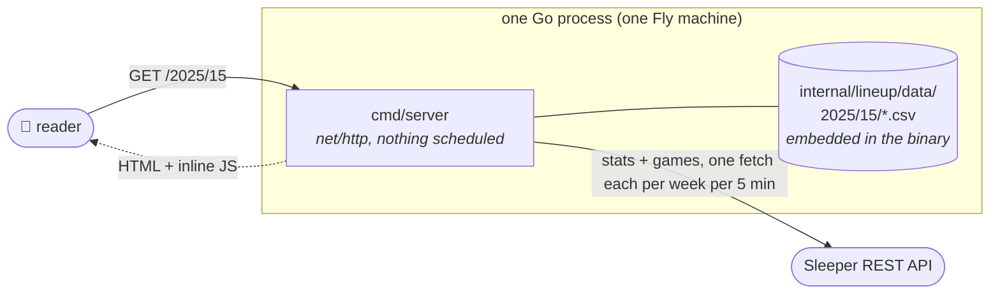
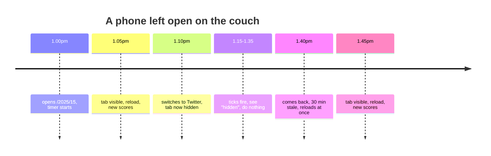
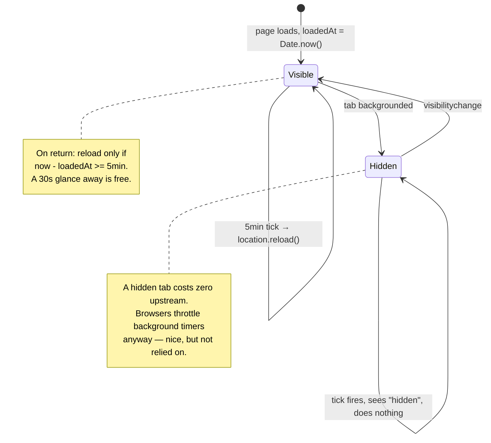
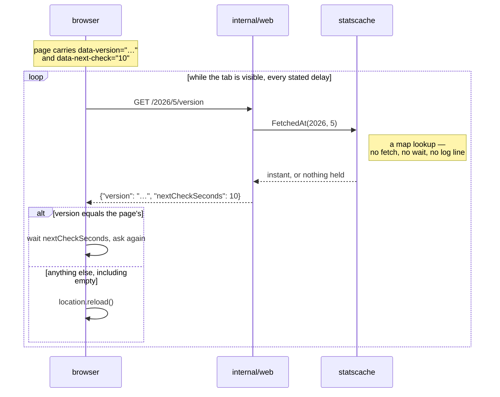
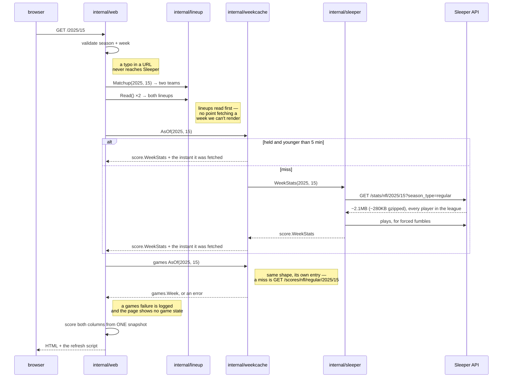
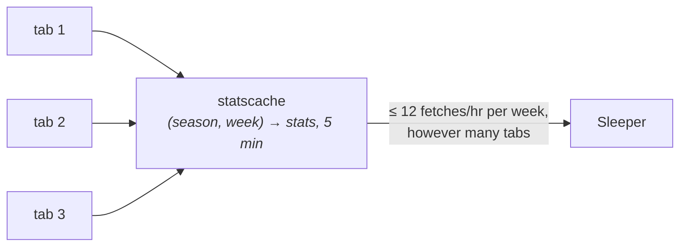
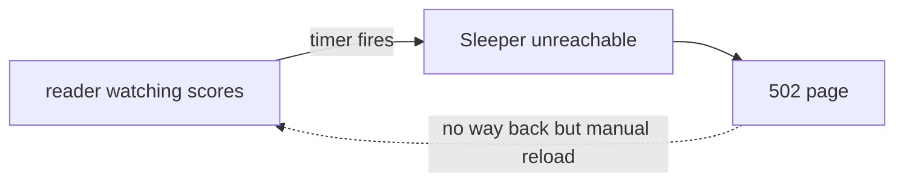
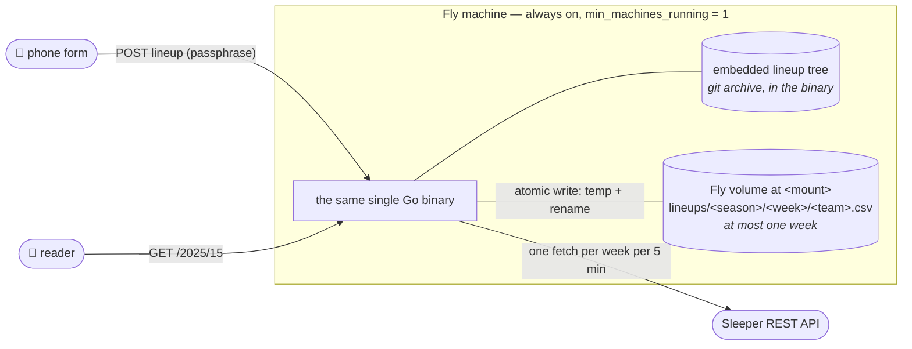
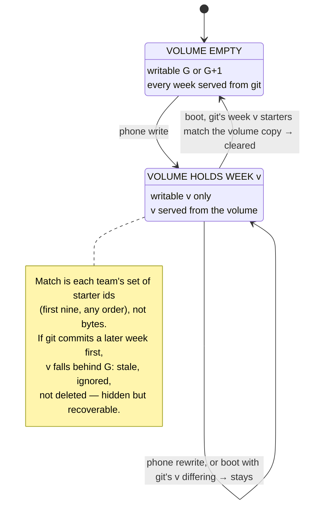

# Architecture

How the running system behaves, from the reader's side and from the traffic's side.
Package-level structure lives in [package-dependencies.md](package-dependencies.md); this is the
altitude above that. Sections 1–4 are the system as built; section 5 is phone-writable lineups on a
Fly volume, whose read side is built and whose write side and deployment are planned.

## The whole thing, one picture

Two things worth internalising:

- **The server is boring.** Request in, response out. No cron, no scheduler, no per-viewer state,
  no sockets held open. Nothing starts work on its own: the one thing that outlives a request is a
  whole-week play fetch that a page request started and did not wait for (at most one per week at a
  time; see "The math" in section 3). With no requests arriving and none of those running, it's
  asleep in an accept loop.
- **The clock lives in the browser.** The page that goes out carries a short vanilla-JS script
  that reloads it: on a five-minute timer, and sooner when a cheap check says the server no longer
  holds the stats the page was rendered from. That's the entire "live" mechanism.

## 1. What the reader gets

Three routes, all `GET`:

| Route | Answers |
| --- | --- |
| `/{season}/{week}` | the matchup page |
| `/{season}/{week}/version` | which fetch the server holds for that week, as JSON; never fetches |
| `/{season}` | a redirect to that season's latest week |

The page is two columns, nine starters each, a total per side. Each starter's line also says where
their NFL team's game stands: a kickoff (`Sun 12p`), the quarter, `Final`, or `Bye`. No margin, no leader
highlight, no win probability — [ADR 0004](adr/0004-web-frontend-stack.md) #8, and the refresh
script is bound by it too (it never touches the previous page's values).

The reader opens it Sunday at 1pm and puts the phone down. What happens next:

The point isn't saving a click. **A stale page and a current page look identical** — nobody hits
refresh on a page they don't suspect. Left alone, the page keeps itself honest.

For the case where the timer breaks or bfcache leaves a tab weird, the page says how old it is: one
line under the columns, "Sleeper stats fetched Sun, Oct 11 2026 1:24 PM CDT". That is the instant
the stats were fetched from Sleeper, not the instant the page was requested, so a page served from
the cache dates itself honestly.

Both instants are served in Central time; the kickoff carries no zone label and the as-of line
does. The page script rewrites each into the reader's own timezone: a kickoff stays unlabelled, and
the as-of line takes the reader's zone abbreviation. If the rewrite fails, the Central text stays.

## 2. The refresh loop

Per **page load** — a new tab is a new document with its own independent clock, and a reload throws
the old one away and starts fresh at zero. Nothing is persisted; no cookie, no localStorage.

Deliberately **not** fetch-and-swap: `location.reload()` re-runs the server path we already trust,
and the document is two short lists. The cost of that choice is section 4.

### The version check

The timer answers "this page is old". It cannot answer "this page has been superseded": when a
whole-week play fetch lands after the cold wait, the server drops the week's cached stats seconds
after the first render, and the timer would not notice for five minutes. The check closes that gap,
and it reacts to any invalidation, not to that one cause.

- **The version is the fetch instant**, in Unix nanoseconds, as an opaque token. The script compares
  it for equality and never parses it. One Go function formats it for both the page and the
  endpoint; two formatters that disagreed would reload every check.
- **Empty means "nothing held"**: never fetched, invalidated, a fetch in flight, or a restarted
  machine. Each of those is a mismatch, so the page reloads into whatever the server would serve now.
- **Age is not a change.** An entry past its TTL still reports its instant. "Old" stays the timer's
  job and "superseded" the check's, so the two never fight.
- **The server sets the pace.** The page states the first delay and every response states the next;
  `0` means stop until the next load. Today it is ten seconds everywhere, from one constant.
- **A failed check never reloads.** An error status, an unreadable body, a route that does not exist
  on an older build: the page stays as it is and asks again after the delay it last used.
- **A hidden tab asks nothing**, as with the timer; it waits the same delay again, so a returning
  reader is checked within one delay.

The check's response is never written into the document. Its one effect is the same reload of the
same URL the timer makes, which is why the "no fetch-and-swap" rule above still holds.

The cost: a visible tab now makes a small request every ten seconds, so the Fly machine stays
running while someone is watching (ceiling: the machine running all month, about $2). None of those
requests reaches Sleeper.

## 3. Where the traffic goes

One page load is at most two upstream fetches, stats then games, and usually none: each is held in
memory for five minutes and shared by every reader.

Two invariants in there: the lineup tree is consulted before the network, and both columns are
scored from a single fetch so the two sides can never come from different snapshots of the week.
Games are read after stats, so a stats failure (the 502 of section 4) costs no games fetch. A games
failure never fails the page: game state annotates the scores, so the page is served without it.

### The math

**Two caches, server-side and shared.** `statscache` and `gamescache` are the same
`weekcache.Cache` over one `sleeper.Client`, with the same TTL, each keyed by `(season, week)`, so
each is the same entry for every tab on every device, and clearing your browser cache does nothing
to them. There is no browser-side cache. Everything below holds for both; the math above is per
cache, so a week costs at most 24 fetches an hour.

- **TTL of five minutes**, the same as the refresh timer. Upstream volume is bounded by the TTL and
  the number of weeks being read, not by the number of readers.
- **Single-flight.** Readers who arrive during a fetch wait on it instead of starting their own.
  The fetch is detached from whoever started it, so the first reader closing their tab does not
  fail the others.
- **Pull-driven.** Nothing sweeps and nothing polls; an expired entry is refetched only when someone
  asks for it. The visibility guard still matters for that reason: a hidden tab never asks.
- **Failures are not stored.** A failed fetch is returned to the readers waiting on it and dropped,
  so the next request tries again.
- **Invalidation.** Forced fumbles come from plays. A cold week's whole-week play fetch is waited on
  only briefly (`PLAYS_COLD_WAIT`); when it lands later and changes anything, the week's entry is
  dropped so the next read is fresh. The version check in section 2 is what brings an open page back
  for that read. This drops only the stats entry; `gamescache` is untouched, and the version token
  is the stats fetch instant alone.

## 4. The sharp edge

Sleeper is down → the handler refuses to serve a zeroed page (correct: "we don't know" ≠ "they
scored nothing") → **502 replaces the scores the reader was looking at.**

The version check can do this too: a check that finds the week invalidated reloads the page, and if
that reload's fetch fails the reader gets the same 502.

This is the real cost of reload-over-swap. The cache makes it rarer, since an outage shorter than
what is left of an entry's five minutes is never seen, but a reload that needs a fetch during an
outage still gets the 502. Fetch-and-swap would kill it entirely at a complexity cost we said no to.

Also live: Sleeper revises stats, so a total can go *down* across a refresh with nothing on the page
explaining why. Pre-existing, but refreshing turns it into something the reader watches happen.

## 5. Writable lineups (read side built)

This section is the design decided in
[ADR 0005](adr/0005-writable-lineups-on-a-volume.md) — set a lineup from a phone without a laptop,
git, or a deploy.

| Part | State |
|---|---|
| Two-layer read: embedded tree + volume (`internal/lineup/layered.go`) | **built** |
| Stale volume weeks ignored and logged, never deleted | **built** |
| Phone form, passphrase, atomic write | planned |
| Boot-time clear once git's week matches the volume | planned |
| Fly volume mount, `LINEUP_VOLUME` set, `min_machines_running = 1` | planned — `fly.toml` has no mount and runs `min_machines_running = 0` |

### Deployment

The read is two layers, and is built. `LINEUP_VOLUME` names the mount; the server reads only
`<mount>/lineups/`, so nothing else on the mount (`lost+found`) reads as a season. Unset, the
embedded tree is the only tree. The volume's week wins **only if it is at or after** the embedded
tree's latest week (a new week, or a phone edit of the latest archived one); every other week comes
from the embedded tree. A volume week older than that is stale: **ignored and logged, never
deleted** — it may hold edits that never reached git. If the volume holds more than one eligible
week, only the latest is served and the rest are logged as superseded. The volume is re-scanned per
read, so a week written while the server runs is served without a restart. An empty or missing
volume reads exactly like the embedded tree alone. Sleeper is untouched: still one fetch per
request.

`PLAYS_COLD_WAIT` sits beside `LINEUP_VOLUME` in the environment. It bounds how long the first read
of a week with no plays held waits for that week's whole-week play-by-play fetch, so turnover forced
fumbles show on first load. Unset means `30s`; `config/local.env` sets `10s` for local runs, and
`fly.toml` sets `3s`, so the deployed app waits only briefly. A malformed or negative value stops
the server at startup.

### What the volume holds (planned)

`G` = the embedded tree's latest week. The app, not a human, keeps the volume to the one in-flight
week. Nothing writes or clears the volume yet: the transitions below need the write path and the
boot-time clear.

Archiving a week is committing the volume's version to git and deploying; the next boot sees the
match and clears it. Clearing happens only at boot, so a phone edit that reverts to git's copy
leaves the volume holding a duplicate until the next restart or deploy. That's harmless: it scores
the same starters git would. Clearing on presence alone would erase a phone edit of an archived week
on every deploy, which is why the starters must match. Starter order and bench rows are left out of
the match: neither is scored, so losing them to git's version on a clear costs nothing.
