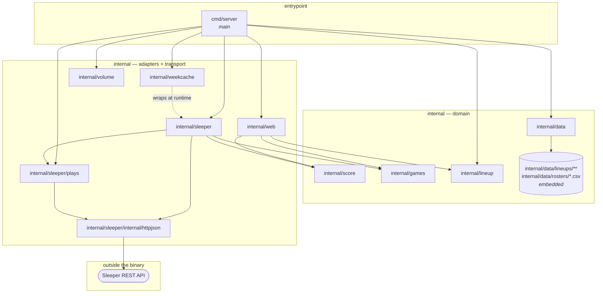

# Package Dependency Map

A one-page picture of how the Go packages relate, so a design question ("where does this belong?",
"what would that import cost me?") can be answered by looking rather than by reading code.

Scope: first-party packages only. Standard-library imports are listed per package below because
they say a lot about what a package *is* — `net/http` marks a boundary, `embed` marks
the package that carries the league files, `html/template` marks the one package that renders, and
`os/signal` marks the one package that owns the process's life and death.

## The map



Every arrow into the domain points inward, and nothing but `main` names a provider. That is the
shape [ADR 0002](adr/0002-live-scoreboard-backend.md) asked for, now held by the compiler rather
than by a comment.

The invariant is directional, not a count: `score`, `games`, and `lineup` must not import `sleeper` or `web`. `score` also takes no stdlib import that would commit the domain to something it should
not decide — no `net/http`, `os`, or `io` (side effects), and no `encoding/json` (a wire format).
It does import `fmt`, which commits it to nothing: a validation error naming the seasons the
league could have played is domain vocabulary, not transport.

Worth knowing that this is a weaker guarantee than it looks: `StatLine` already carries `json`
struct tags, which need no import and so cost nothing by any import metric while still encoding a
serialization decision. Read the direction of the arrows, not the length of the import lists.

## The packages

| Package | Role | Imports (first-party) | Imports (stdlib) | Imported by |
| --- | --- | --- | --- | --- |
| `cmd/server` | Process entrypoint and composition root. Reads its configuration from the environment, claims the volume and drops root, constructs the play store and the provider, wraps its stats and its games each in a cache, constructs the lineup tree, builds the mux, and owns the process lifecycle: listen address, connection timeouts, and the drain on `SIGTERM`. | `internal/data`, `internal/lineup`, `internal/sleeper`, `internal/sleeper/plays`, `internal/volume`, `internal/web`, `internal/weekcache` | `context`, `errors`, `fmt`, `log`, `net`, `net/http`, `os`, `os/signal`, `syscall`, `time` | — |
| `internal/score` | The scoring domain: `StatLine`, `Points`, `WeekStats`, and the season/week bounds. | none | `fmt` | `internal/sleeper`, `internal/web` |
| `internal/games` | A week's NFL games, provider-neutral: `Game`, its `State`, and `Week` with `ForTeam`. | none | `time` | `internal/sleeper`, `internal/web` |
| `internal/sleeper` | The Sleeper adapter: `Client`, the base URL, the stat-key transform, and the scores endpoint read into `games.Week`. | `internal/games`, `internal/score`, `internal/sleeper/internal/httpjson`, `internal/sleeper/plays` | `context`, `fmt`, `time` | `cmd/server` |
| `internal/sleeper/plays` | The play store: the plays endpoint, Sleeper's play JSON, and forced-fumble attribution from play descriptions. | `internal/sleeper/internal/httpjson` | `context`, `fmt`, `regexp`, `strconv`, `strings`, `sync`, `time` | `cmd/server`, `internal/sleeper` |
| `internal/sleeper/internal/httpjson` | `Get`: one GET decoded from JSON, over the one timed `http.Client`. | none | `context`, `encoding/json`, `fmt`, `net/http`, `time` | `internal/sleeper`, `internal/sleeper/plays` |
| `internal/weekcache` | A caching decorator over any weekly fetch, generic over its value: TTL expiry, single-flight, the `TTL` constant. | none | `context`, `log`, `sync`, `time` | `cmd/server` |
| `internal/web` | The HTML transport: `GET /{season}/{week}`, its view model, its template. | `internal/games`, `internal/lineup`, `internal/score` | `bytes`, `context`, `embed`, `encoding/json`, `errors`, `html/template`, `log`, `net/http`, `strconv`, `strings`, `time`, `time/tzdata` | `cmd/server` |
| `internal/lineup` | Lineup knowledge: file format, tree layout, matchup resolution, slot assignment. It reads any `fs.FS` and embeds none. | none | `bufio`, `errors`, `fmt`, `io`, `io/fs`, `path`, `path/filepath`, `slices`, `strconv`, `strings`, `unicode`, `unicode/utf8` | `cmd/server`, `internal/web`, `internal/data` (tests only), `internal/volume` (tests only) |
| `internal/volume` | Chooses the lineup tree to serve (embedded, or the store on the Fly volume), and seeds that store from the embedded tree, per week, against a hash manifest. The only package that writes lineup files. | none | `crypto/sha256`, `encoding/hex`, `encoding/json`, `errors`, `io/fs`, `os`, `path`, `path/filepath`, `strconv` | `cmd/server` |
| `internal/data` | The league files carried in the binary: the lineup tree and the per-team rosters, each an `fs.FS` rooted below its directory. | none | `embed`, `io/fs` | `cmd/server`, `internal/volume` (tests only) |

### `cmd/server`

Thin by design, and the only place the provider and the transport meet: it constructs a
`plays.Store`, a `sleeper.Client` holding it in `Plays`, and a `lineup.Tree` and hands them to the
`web` handlers, which know only the interfaces `web` declares for itself: `StatsSource` and
`GamesSource` (`AsOf`) and `VersionSource` (`FetchedAt`), satisfied by the two wrapped caches.
`mux.go` joins `StatsSource` and `VersionSource` into one `weekStats` parameter, so the page and
its version endpoint cannot be wired to different caches. If
logic starts appearing here, it belongs in a package instead — `main()` should stay readable as a
table of contents for the service.

The tree served is chosen at one call site: `main` hands `volume.Lineups` the embedded
`data.Lineups` and the `LINEUP_VOLUME` mount, and passes whatever `fs.FS` comes back to
`lineup.New`. With no mount that is the embedded tree; with one it is the seeded store on the
volume. Either way no path relative to the working directory survives.

Because the wiring is here, the TTL cache landed as pure addition: `weekcache.New` wraps the
`sleeper.Client`'s `WeekStats` method value in this file and the wrapped value goes to both handlers, with no consumer edited
and no handler file touched. Wrapping once matters — a cache per handler would be two upstream
budgets for one league — and it is the kind of thing only a composition root can guarantee. Games
arrived the same way: a second `weekcache.New("gamescache", client.WeekGames, weekcache.TTL)` over
the same client. Only the stats cache is hooked to the play store's invalidation —
`playStore.OnWholeWeekChanged(stats.Invalidate)` — so dropping a week's stats leaves its games alone.
`main` imports `plays` for that store, and passes it `sleeper.BaseURL` so the base URL stays named
in one package.

The package is no longer one file, and the split is what made it testable at all. `main()` is the
untested few lines that name the real environment, the real signal disposition, and the real
address; everything it calls takes those as arguments and lives beside it:

- **`config.go`** — `loadConfig(getenv)`, every environment read in one struct: `PORT` (default
  `8080`), `PLAYS_COLD_WAIT` (a Go duration, default 30s, rejected if malformed or negative), and
  `LINEUP_VOLUME` (empty means no volume). The lookup is a parameter so a test passes a map instead
  of mutating the process environment.
- **`privileges.go`**, **`privileges_linux.go`**, **`privileges_other.go`** —
  `claimVolumeAndDropRoot(volume)`. Run as root, it chowns the volume mount to the distroless
  `nonroot` user and then drops to it, before any disk or network work. Not as root, it does nothing; as root off Linux, it refuses to start.
  The syscalls are fields of a `privileges` struct so a test can record their order.
- **`mux.go`** — `newMux(stats, games, tree)` returns an owned `*http.ServeMux`. Registering on
  `DefaultServeMux` made the routing table process-wide state that could not be built twice in one
  test binary without a duplicate-pattern panic; as a value it can be built and driven with
  `httptest`.
- **`server.go`** — `newServer(addr, h)`, the one place the four connection timeouts are set:
  read-header 5s, read 10s, write 30s, idle 60s. `http.ListenAndServe` leaves all four at zero,
  which on a 256mb machine means a handful of silent connections is the whole budget. The write
  timeout does not cover a matchup page's worst case, two back-to-back cache misses of up to 30s
  each, and doesn't need to: the cache's fetches outlive the request, so the next load is a hit.
- **`run.go`** — `run(srv, listen, stop, grace)`. Serves in a goroutine and selects on the serve
  error and the stop channel; on stop it drains through `srv.Shutdown` under a 15s bound. Both
  `listen` and `stop` are parameters for the same reason `getenv` is: a test binds port `0` or
  hands back a bind failure, and fires the drain, without the test binary signalling itself.

The signal is the point. Fly stops a machine with `SIGTERM` — on deploy and on the idle
`auto_stop_machines` path — so a process that dies on it cuts every open response mid-body.

### `internal/score`

The domain. Four files, and `fmt` is the whole of its stdlib surface:

- **`calc.go` — the rules.** `Points(StatLine) float64`.
- **`stats.go` — the vocabulary.** `StatLine`, provider-neutral. Deliberately carries no points
  field, so a stat line can never hold a stale total.
- **`weekstats.go` — the snapshot.** `WeekStats`, one season and week's stat lines keyed by player
  ID, built by an adapter through `NewWeekStats` and read through `Player`. It lives here rather
  than in the adapter so that consumers can name it without importing a provider — that is what
  makes the boundary structural rather than decorative. It is complete when returned and never
  written afterwards, so concurrent handlers can share one.
- **`bounds.go` — what may be asked about.** `ValidateSeasonWeek`. The bounds live in the domain
  because they are a league fact, not a URL rule: `web` validates its URL segments against them,
  and any other way into the scoring path would have to refuse the same nonsense.

### `internal/games`

The second domain vocabulary, shaped like `WeekStats`: a week's games, built by an adapter through
`NewWeek` and read through `ForTeam`, so `web` can show a starter's game state without importing a
provider. A game is found by team code, matched exactly, and `Empty` tells a week with no games
apart from one team's bye. `State` maps the provider's status into upcoming, in progress, complete,
or `Other`, which keeps a status never seen before rather than guessing; the provider's quarter and
status text ride along as sent, and the wording is `web`'s choice. `time` is its only import.

### `internal/sleeper`

With its two subpackages, the only code that talks to the network, and the only package in which a
Sleeper stat key appears — a fact worth re-checking by grep rather than trusting. Sleeper shapes
appear only under `internal/sleeper/`. `Client` is its one entry point, holding the base URL in a
field so `main` wires a value. `Client.WeekStats` fetches once and transforms **every** entry in the
payload, so the decoded `map[string]map[string]float64` never outlives the call. Files are named for
their role: `client.go` holds `Client`, and `stats_endpoint.go` and `scores_endpoint.go` each hold
one Sleeper endpoint's wire shape and translation. The second is not the `games` package; it fills
one.

`Client.WeekGames` reads the scores endpoint (`/scores/nfl/regular/<season>/<week>`), which unlike
the schedule endpoint carries kickoff and quarter, and translates Sleeper's fields only. An unplayed
week answers `[]`, an empty week rather than an error.

Forced fumbles are not in the stats payload, so `Client` asks its `Plays *plays.Store` for them,
handing over the `plays.Identities` it built from that payload. A nil `Plays` scores without them.
`net/http` and `encoding/json` are gone from its imports: every request goes through `httpjson.Get`.

Mapping the whole payload rather than the ~18 players a request wants is a deliberate cost, measured
rather than assumed: about 0.7 ms against the 13 ms JSON decode that produced its input. See
[ADR 0003](adr/0003-sleeper-as-initial-stat-provider.md) for why Sleeper is currently the only
provider.

### `internal/sleeper/plays`

The play store, split out of `internal/sleeper` because it is a subsystem of its own: the plays
endpoint, Sleeper's play JSON, and the parsing of play descriptions into forced-fumble credits. It
sits under `internal/sleeper/` because those shapes and that text are Sleeper's. `Store` polls
recent plays on each read and backs them with a whole-week fetch in the background;
`OnWholeWeekChanged` tells a cache when that fetch lands. `sync` and `regexp` are the imports that
mark it: shared state across requests, and description text read for names.

`Identity` has unexported fields, so `NewIdentity` is the only way to build one and name
normalization stays here. It cannot import `sleeper`, which imports it.

### `internal/sleeper/internal/httpjson`

A leaf both Sleeper packages import, so they share one 15-second `http.Client` and one set of error
wording rather than two that drift. `internal/` limits its importers to the `internal/sleeper`
tree. It has no tests of its own; its callers' `httptest` servers exercise it.

### `internal/data`

The league files and nothing else. `go:embed` cannot reach outside its own package directory, so
the files and the directives that embed them live together here, and any package that wants them
imports this leaf rather than reaching into another package's directory. `Lineups` (the
`<season>/<week>/<team>.csv` tree) and `Rosters` (one `<team>.csv` per team, same
`id,name,position,team` format) are each an `fs.FS` rooted below their directory, so a new season
is a new directory rather than an edit to a directive.

### `internal/lineup`

Pure domain plus a file reader; no network, no HTTP. It owns the `id,name,position,team` record format, the
`<season>/<week>/<team>.csv` layout, and the slot rule: a file holds exactly nine records,
assigned to `QB RB WR TE FLEX FLEX K D D` by position, with file order breaking ties.

It does not hold the tree; `internal/data` does. `Tree` reads through whatever `fs.FS` it is handed and never defaults to the
embedded one — naming the tree is `main`'s job ([ADR 0004](adr/0004-web-frontend-stack.md) #3).

It also answers a question the lineup files alone can't: *who is playing this week*.
`Tree.Matchup` lists a week directory and returns the two team names, ours first, refusing anything
that is not exactly two lineups with `bojjaes.csv` among them. That is why the package now imports
`errors` — the four refusals are sentinel values so a caller can tell an unstaged week from a stray
third file. The rule lives here rather than in the first handler that needs it, because a week
directory holding one matchup is a fact about the tree's layout, and the layout is stated in this
package and nowhere else.

`internal/web` is its one consumer, which is what it was built for.

`Tree.LatestLineup` answers the other tree-wide question: the newest week holding a team's lineup,
which is the lineup a team is assumed to start until it files another. It is computed from the
tree rather than kept as a copy, so it cannot go stale.

The package is two files along that seam: `record.go` (the CSV format, `Record`, `Lineup`) and
`tree.go` (`Tree` and everything that locates files). The tree reaches the format through one call,
in `Read`.

### `internal/volume`

The one package that writes lineup files, split out of `lineup` so that package stays a pure
reader. `Lineups(embedded, mount, logf)` is the tree to serve: `embedded` when there is no mount,
otherwise the mount's `lineups` subdirectory after seeding it. The mount is not the tree itself, so
nothing else on it (the manifest, `lost+found`) reads as a season. `Seed` copies each numbered week of the embedded tree onto the mount, replacing a week only
when git's copy changed since it was last seeded, per `seed-manifest.json`; the rules are in
[architecture](architecture.md). It uses nothing of `lineup`'s: it copies files by directory shape
and never parses one. `os` and `crypto/sha256` are the imports that mark it.

### `internal/weekcache`

A decorator, not a layer. `Cache[V]` wraps a `Source[V]`, a plain function
`func(ctx, season, week) (V, error)`, so `main` hands it a provider's method value and the cache
names neither a provider nor a domain type. `*Cache[score.WeekStats]` is a `StatsSource` for `web`
as it stands, because `web` asks for `AsOf(ctx, season, week) (score.WeekStats, time.Time, error)`
and Go matches the method's shape, so no adapter sits between them and a served page can date its
stats to the fetch. Installing it is `main` wrapping one value in another; removing it is deleting
that wrap. `New` takes a label that opens each hit and miss log line; the stats cache's is
`statscache`.

It holds one entry per `(season, week)` — a fetch returns the whole league, so there is no partial
hit — and it does two things to bound upstream volume. The TTL caps how often a week is refetched;
single-flight collapses concurrent misses for the same week into one call, which is what a page
that refreshes itself on a timer actually needs. Neither is optional now that a browser, not a
person, decides how often the fetch happens.

Three rules are worth knowing before changing it: failures are never stored (a blip would otherwise
become a whole TTL of errors); the fetch runs on `context.WithoutCancel` under the cache's own
timeout, so the reader who happened to start it cannot cancel it out from under the others; and the
mutex is never held across the fetch, so a slow week cannot block a different one. The reasoning
is in comments at each site and in the change's notes.

`now` and `fetchTimeout` are unexported seams for tests, not configuration — `main` names neither.

### `internal/web`

The HTML edge, and the third thing this map used to predict: it imports the domain packages so
none has to import another. It resolves a week to two teams through `lineup.Tree`, reads both
lineups, fetches the week's stats **once**, and scores both columns from that one snapshot — the
two columns must not come from different readings of the week. Then it fetches the week's games,
after the stats so a stats failure costs no games fetch, and finds each starter's game by the
lineup record's `Team`. A games failure is logged and the page is served with no game state.

The page's script rewrites the served Central-time instants into the reader's timezone: a kickoff
(`Sun 12p`, served with no zone label) stays unlabelled, and the as-of line takes the reader's
zone abbreviation.

It declares its own `StatsSource` and `GamesSource` and never imports `internal/sleeper`, so its
tests build a `score.WeekStats` with `NewWeekStats` and a `games.Week` with `NewWeek` rather than standing up an `httptest` server. That is what let
the TTL cache arrive as a wrapping `StatsSource` wired in `main` with nothing here edited.

`embed` and `html/template` are the imports that mark it: `matchup.html` lives beside the handler
and is parsed once at package initialisation, so a broken template stops the process at startup
rather than the first request. The handler renders into a `bytes.Buffer` and writes only on
success, since executing straight into the `ResponseWriter` would commit a `200` and half a page
before it could fail.

## What the shape tells you

- **`score`, `games`, and `lineup` still do not know about each other.** A lineup is a list of
  player IDs; scoring takes player IDs. A record's `Team` is the key to its game, but as a string,
  so `lineup` needs no `games` type. None needs another's types. They meet in callers —
  `cmd/server` and `internal/web`.
- **The next edge was a third thing, as expected.** The served page arrived as `internal/web`,
  importing both, rather than `lineup` importing `score` (which would drag a transport concern into
  a pure domain package) or the reverse. Expect the same of the next consumer: a season-long view
  or a lineup submitter is another package beside `web`, not a new edge between the two domains.
- **Growth pressure lands on the adapters, not the domain.** The `internal/sleeper` tree carries the network
  dependency and `internal/web` the HTML one; `internal/score` has none of them, and a change to
  either cannot reach it without an import that is not there.
- **A few tests add first-party edges the map does not show.** Every test is in-package, and there
  are still no third-party dependencies anywhere in `go.mod`. `cmd/server` has tests now, and they
  add test-only edges to `internal/score` and `internal/games`: the stubs that stand in for the caches
  have to return a `score.WeekStats` and a `games.Week`. But `internal/weekcache`'s tests import `internal/web` and `internal/score` to
  assert at compile time that `*Cache[score.WeekStats]` satisfies its `StatsSource` (and
  `internal/games`, to exercise the games cache), and
  `internal/web`'s tests now import `internal/weekcache` to serve a
  page end to end over a real cache and check that a cache hit dates its stats to the fetch. Those
  edges are deliberate and test-only: the substitutability and the freshness attribution are the
  whole point of the decorator, so they are better checked in the packages' own tests than
  discovered in `main`. They are also where the "read the arrows" advice needs the second `go list`.
  `internal/volume`'s tests import `internal/lineup`, to check that a seeded store reads back
  as a matchup, and `internal/data`, to seed from the real embedded tree.
  Both `lineup`'s matchup tests and `web`'s page tests build their fixtures with `fstest.MapFS`,
  so nothing writes to disk and almost nothing reads the real tree. The exception is deliberate:
  `internal/data`'s tests (as the external `data_test` package) import `lineup` and walk every week of `data.Lineups`, asserting each is a matchup and that both
  lineups parse. It is a test of the data, not of the reader — with every other test on a `MapFS`,
  a malformed CSV or a week with three files would otherwise build clean and fail at request time.

## Keeping this current

The edges are generated, so verify rather than remember:

```sh
# first-party edges
go list -f '{{.ImportPath}}: {{join .Imports " "}}' ./...

# including test-only imports
go list -f '{{.ImportPath}}: {{join .TestImports " "}} {{join .XTestImports " "}}' ./...
```

If the output disagrees with the map above, the map is stale.
